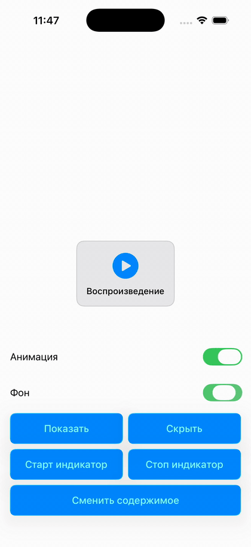
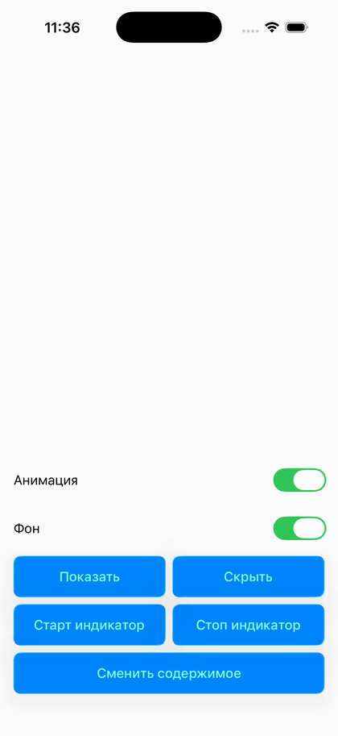
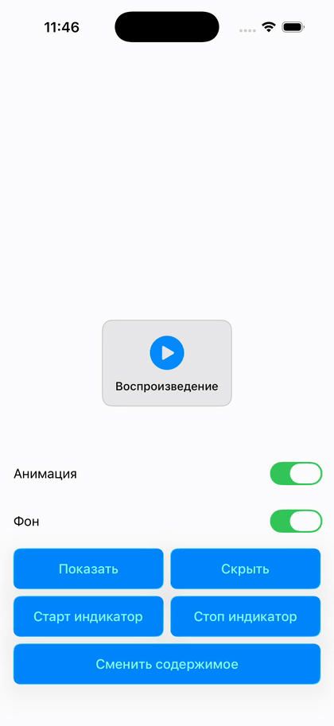
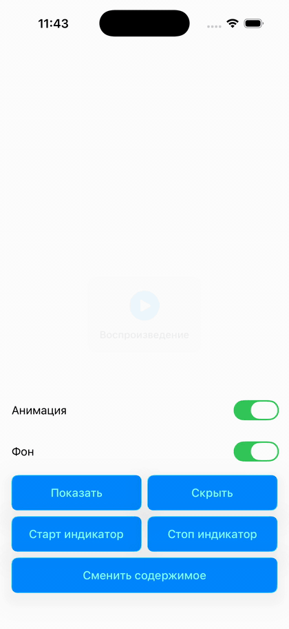

# ActivityLabel

Компонент для отображения изображения с текстовой меткой и встроенным
индикатором загрузки на базе `UIStackView`.

`LabelView` объединяет `UIImageView` и `UILabel` в единый блок содержимого,
который анимируется как одно целое, а индикатор `UIActivityIndicatorView`
может отображаться над ним или вместо него.

## Требования

- iOS 15.0+
- Swift 5.9+
- Xcode 15+

## Установка

Пакет распространяется через Swift Package Manager:

```swift
dependencies: [
    .package(url: "<url репозитория>", from: "1.0.0")
]
```

## Быстрый старт

```swift
import ActivityLabel

// Создание с изображением и заголовком
let labelView = LabelView(
    imageSystemName: "play.circle.fill",
    title: "Воспроизведение"
)

// Настройка внешнего вида
labelView.textColor = .label
labelView.font = .systemFont(ofSize: 14, weight: .medium)
labelView.imageContentMode = .scaleAspectFit
labelView.spacing = 8
labelView.directionalContentInsets = NSDirectionalEdgeInsets(
    top: 16.0, leading: 16.0, bottom: 16.0, trailing: 16.0
)

view.addSubview(labelView)
```

## Фон

Оформление фона задаётся через `UIBackgroundConfiguration` — как
`background` у `UIButton.Configuration`. Настройки применяются напрямую
к `layer` метки и анимируются внутри `UIView.animate`.



```swift
var background = UIBackgroundConfiguration.clear()
background.backgroundColor = .secondarySystemFill
background.cornerRadius = 12.0
background.strokeColor = .systemGray3
background.strokeWidth = 1.0

labelView.background = background // включить фон
labelView.background = nil        // отключить фон
```

Поддерживаются цвет фона, скругление углов, обводка и тень
(iOS 18+). `backgroundInsets`, `visualEffect`, `image` и `customView`
не поддерживаются.

## Отображение и скрытие



```swift
// Смена содержимого с анимацией
labelView.show(
    imageSystemName: "pause.circle.fill",
    title: "Пауза",
    animated: true
)

// Скрытие с анимацией
labelView.hide(animated: true)

// Скрытие только содержимого — индикатор и метка остаются видимыми
labelView.hideContent(animated: true)
```



Длительность анимаций настраивается свойством `animationDuration`
(по умолчанию `0.3` секунды).

## Индикатор загрузки



```swift
labelView.startActivityAnimating()
labelView.stopActivityAnimating()

labelView.isActivityAnimating // признак запущенной анимации
```

Запуск индикатора показывает метку. Если содержимое метки скрыто,
индикатор отображается один, а после остановки пустая метка
скрывается. Иначе индикатор плавно появляется над содержимым
и так же затухает.

Конкурентные команды безопасны: если во время затухания метки
или индикатора приходит противоположная команда, цепочка
анимаций не приводит метку в ложное скрытое состояние.

## Основные свойства

| Свойство | Описание |
| --- | --- |
| `image` | Изображение для отображения |
| `title` | Текст метки |
| `textColor` | Цвет текста |
| `textAlignment` | Выравнивание текста |
| `font` | Шрифт текста |
| `numberOfLines` | Максимальное количество строк (`0` — без ограничений) |
| `imageContentMode` | Режим отображения изображения |
| `spacing` | Отступ между элементами |
| `directionalContentInsets` | Внутренние отступы содержимого с поддержкой RTL/LTR |
| `background` | Конфигурация фона метки |
| `animationDuration` | Длительность анимаций |
| `activityView` | Встроенный индикатор загрузки (только чтение) |
| `imageView`, `label` | Доступ к внутренним компонентам (только чтение) |

## Демо-приложение

В каталоге `ActivityLabelDemo` находится пример приложения,
демонстрирующий отображение и скрытие метки и её содержимого,
смену содержимого, индикатор загрузки и переключение фона.

## История изменений

См. [CHANGELOG.md](CHANGELOG.md).
